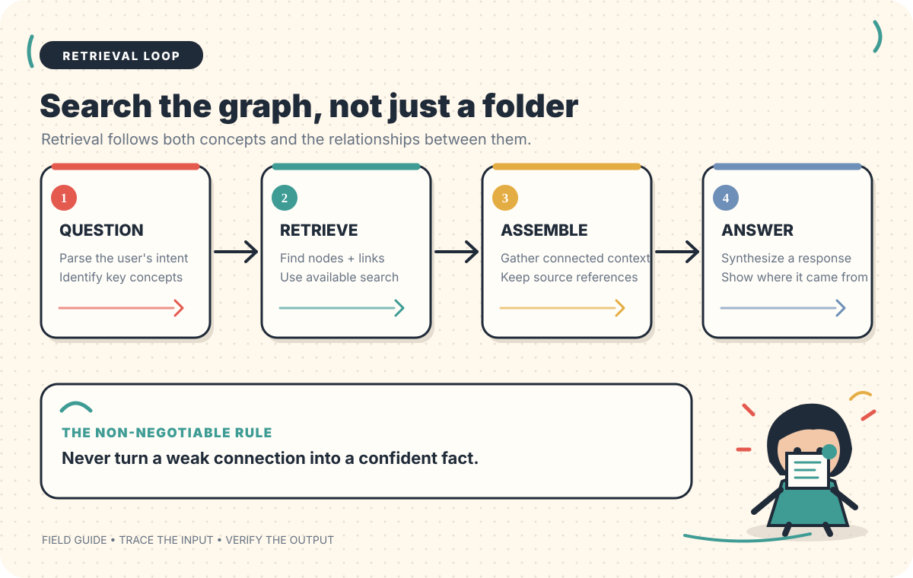
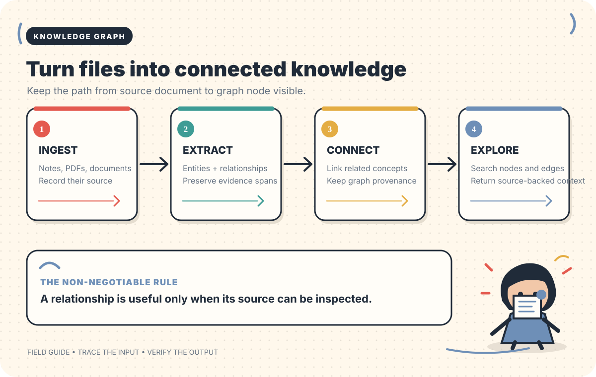
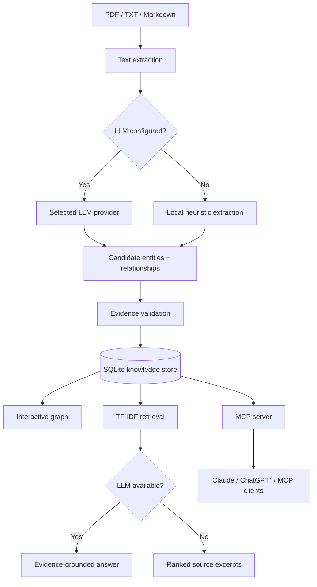

<!--
  Personal Knowledge Graph Agent
  Agent #7 / 200 AI Agents in 200 Days
-->

<div align="center">

# 🧠 Personal Knowledge Graph Agent

### Your knowledge shouldn't live in disconnected files.

**Turn documents, notes, research and ideas into a connected, searchable knowledge graph — powered by the LLM you choose.**

<br/>

[](https://github.com/yerageracharan)
[](https://www.python.org/)
[](https://streamlit.io/)
[](https://modelcontextprotocol.io/)
[](LICENSE)

<br/>

[**Get started ↓**](#-get-started-in-5-minutes) · [Features](#-what-it-does) · [Providers](#-choose-your-llm) · [MCP integrations](#-connect-ai-assistants-with-mcp) · [Roadmap](#-roadmap)

<br/>

**Local-first · Provider-independent · Evidence-aware · Extensible**

</div>

---

## The idea

Your information is probably scattered across PDFs, lecture notes, research papers, Markdown files, project documentation and random text files.

A normal file search finds words. A knowledge graph helps you explore **how the ideas in those files connect**.

This project is an extensible personal knowledge system. It ingests documents, extracts candidate entities and relationships, stores them, visualises connections and retrieves source passages when you ask questions.

You choose the model:

- **Hosted APIs:** OpenAI or Anthropic.
- **Local open models:** Ollama and compatible local inference servers.
- **Custom endpoints:** any endpoint that implements the OpenAI Chat Completions API.
- **No LLM:** a local heuristic baseline still works without an API key.

> [!IMPORTANT]
> This repository is an actively developed project, not a finished enterprise knowledge platform. The current version provides document ingestion, a first-pass graph, local TF-IDF retrieval, optional LLM extraction/answer synthesis, and MCP tools. Limitations and unfinished work are listed below.

---

## ✨ What it does

<table>
<tr>
<td width="50%" valign="top">

### 📥 Document ingestion

Bring your own knowledge.

- PDF files with extractable text
- Plain text (`.txt`)
- Markdown (`.md`)
- Multiple files in one upload

</td>
<td width="50%" valign="top">

### 🧩 Entity extraction

Identify candidate concepts in your documents.

- People and organisations
- Technologies and tools
- Concepts and topics
- Places, events and other entities
- LLM extraction or local heuristics

</td>
</tr>
<tr>
<td width="50%" valign="top">

### 🔗 Relationship discovery

Connect entities with evidence.

- Co-occurrence relationships in baseline mode
- LLM-proposed relationship labels
- Exact-source-sentence validation for LLM edges
- Supporting evidence retained in the database

</td>
<td width="50%" valign="top">

### 🕸️ Interactive knowledge graph

Explore your information visually.

- Entity nodes
- Relationship edges
- Interactive network view
- Entity and relationship tables
- Source evidence inspection

</td>
</tr>
<tr>
<td width="50%" valign="top">

### 🔎 Knowledge retrieval



*Retrieval follows connected concepts while keeping the source trail attached to the answer.*


Find relevant passages from your own documents.

- Local TF-IDF retrieval
- Ranked evidence snippets
- Source document names
- Optional LLM answer synthesis
- Evidence references in generated answers

</td>
<td width="50%" valign="top">

### 🔌 AI assistant integration

Expose the knowledge base through MCP.

- Add text documents
- Search indexed knowledge
- Ask questions
- Retrieve graph data
- List indexed sources

</td>
</tr>
</table>

---

## 🧭 How it works



*Documents become source-linked entities and relationships that can be explored later.*


<div align="center">



</div>

### Processing flow

1. **Ingest:** the application reads the uploaded file and extracts its text.
2. **Extract:** the configured LLM proposes entities and relationships, or the local heuristic extractor identifies candidates.
3. **Validate:** LLM relationship evidence is accepted only if the quoted sentence appears in the original document. This is a basic provenance check, not a guarantee that the interpretation is correct.
4. **Store:** document text, entities and relationships are saved in SQLite.
5. **Explore:** the Streamlit interface renders the graph and tabular data.
6. **Retrieve:** TF-IDF ranks passages relevant to a question.
7. **Answer:** when an LLM is configured, it receives retrieved evidence and is instructed to answer with source references. Without an LLM, the application returns the retrieved excerpts.

---

## 🚀 Get started in 5 minutes

### Requirements

| Requirement | Details |
|---|---|
| Operating system | Windows, macOS or Linux |
| Python | 3.10 or newer recommended |
| Git | Required to clone and update the project |
| Internet | Needed to install dependencies and use hosted APIs |
| LLM API key | Optional — only required for hosted providers |
| Ollama | Optional — for local model inference |

### Step 1 — Clone the repository

Open PowerShell, Terminal or your preferred shell:

```bash
git clone https://github.com/yerageracharan/personal-knowledge-graph-agent.git
cd personal-knowledge-graph-agent
```

### Step 2 — Create a virtual environment

A virtual environment keeps this project's Python dependencies separate from your other projects.

**Windows PowerShell**

```powershell
python -m venv .venv
.venv\Scripts\Activate.ps1
```

If PowerShell blocks activation, use this command for the current terminal session:

```powershell
Set-ExecutionPolicy -Scope Process -ExecutionPolicy Bypass
.venv\Scripts\Activate.ps1
```

**macOS / Linux**

```bash
python3 -m venv .venv
source .venv/bin/activate
```

### Step 3 — Install dependencies

```bash
python -m pip install --upgrade pip
pip install -r requirements.txt
```

### Step 4 — Start the application

```bash
streamlit run app.py
```

Streamlit will print a local address, usually:

```text
http://localhost:8501
```

Open that address in your browser.

### Step 5 — Add your first documents

1. Open the **Add knowledge** area in the sidebar.
2. Select one or more PDF, TXT or Markdown files.
3. Choose an LLM provider in **Model settings**, or leave the provider set to `none`.
4. Click **Process documents**.
5. Open the **Knowledge graph** tab to explore extracted entities and connections.
6. Open **Entities & relationships** to inspect the current graph data.
7. Open **Ask your knowledge** to retrieve passages relevant to a question.

**First-run tip:** start with two or three short, text-based documents that share a topic. It is easier to inspect whether the graph is sensible when you know the source material.

---

## 🧠 Choose your LLM

The application is designed around a provider abstraction. The graph workflow should not depend on one model vendor.

### Provider compatibility

| Provider | Setting | Model ID example | API key |
|---|---|---|---|
| OpenAI | `openai` | `gpt-4o-mini` | Required |
| Anthropic | `anthropic` | Use a model ID available to your Anthropic account | Required |
| Ollama | `ollama` | `llama3.1` | Not normally required |
| LM Studio | `openai-compatible` | Model ID served by LM Studio | Depends on server |
| vLLM | `openai-compatible` | Model ID served by vLLM | Depends on server |
| Other compatible endpoint | `openai-compatible` | Provider's model ID | Depends on provider |
| No model | `none` | Not applicable | Not required |

> [!NOTE]
> “OpenAI-compatible” means the endpoint implements the OpenAI Chat Completions request/response format. A provider that exposes a different API format needs its own adapter; a URL alone cannot make incompatible APIs interchangeable.

### Option A — Configure a provider in the app

1. Start the app with `streamlit run app.py`.
2. In the sidebar, open **Model settings**.
3. Select the provider.
4. Enter the exact model ID expected by that provider.
5. Enter the API base URL if the provider requires one.
6. Enter the API key if required.
7. Upload a document and process it.

The API key field is a password field in the Streamlit interface. Treat it as a secret and do not share screenshots containing credentials.

### Option B — Use an environment file

The repository includes `.env.example`.

**Windows PowerShell**

```powershell
Copy-Item .env.example .env
notepad .env
```

**macOS / Linux**

```bash
cp .env.example .env
nano .env
```

Example configuration for an OpenAI-compatible endpoint:

```env
LLM_PROVIDER=openai-compatible
LLM_MODEL=your-model-id
LLM_API_KEY=your-secret-key
LLM_BASE_URL=https://your-provider.example/v1

KNOWLEDGE_DB=data/knowledge.db
MCP_TRANSPORT=stdio
```

Save the file and restart the application after changing environment variables.

### Option C — Run an open model locally with Ollama

This option can avoid sending document text to a hosted model provider, provided Ollama itself is running locally and you have not configured a remote endpoint.

1. Install Ollama from [ollama.com](https://ollama.com/).
2. Open a terminal.
3. Download a model supported by your hardware. Example:

```bash
ollama pull llama3.1
```

4. Confirm that the model is available:

```bash
ollama list
```

5. Configure the application:

```env
LLM_PROVIDER=ollama
LLM_MODEL=llama3.1
LLM_BASE_URL=http://localhost:11434/v1
LLM_API_KEY=
```

6. Restart Streamlit and select Ollama in the sidebar.

**Hardware note:** local inference speed and the largest usable model depend on your RAM, GPU memory, quantisation and context length. A model being downloadable does not mean it will run comfortably on every computer.

### Provider-specific notes

- **OpenAI:** use an API key from the OpenAI developer platform. A ChatGPT subscription is not an API key.
- **Anthropic:** use an Anthropic API key and a model ID available to your account. A Claude subscription is not an API key.
- **Ollama:** the application calls Ollama's OpenAI-compatible local endpoint.
- **LM Studio / vLLM:** start the server, enable its compatible API endpoint, then enter its base URL and served model ID.
- **Other APIs:** check whether the endpoint implements Chat Completions. If it does not, implement a dedicated adapter in `src/llm.py`.

---

## 🔌 Connect AI assistants with MCP

The Model Context Protocol (MCP) lets an AI assistant call tools exposed by another application.

This repository includes `mcp_server.py`, which exposes the knowledge base as tools.

### Available MCP tools

| Tool | What it does |
|---|---|
| `add_text_document` | Add a text or Markdown document to the knowledge base |
| `search_knowledge` | Search indexed documents and return evidence passages |
| `ask_knowledge` | Ask a question using the indexed knowledge |
| `get_knowledge_graph` | Return entities, relationships and graph statistics |
| `list_knowledge_sources` | List documents already indexed |

### A. Claude Desktop — local MCP

The local stdio setup is intended for a trusted desktop environment.

**Step 1 — Install the project**

Complete the [quick start](#-get-started-in-5-minutes), including dependency installation.

**Step 2 — Find the absolute project path**

For example:

```text
C:\Users\YOUR_USER\personal-knowledge-graph-agent
```

Use your actual Windows username and folder location.

**Step 3 — Locate Claude Desktop's configuration file**

On Windows, the configuration is normally located at:

```text
%AppData%\Claude\claude_desktop_config.json
```

If the file does not exist, create it. Preserve any other MCP server entries already present.

**Step 4 — Add the server configuration**

Replace the example paths with your actual absolute paths:

```json
{
  "mcpServers": {
    "personal-knowledge-graph": {
      "command": "C:\\Users\\YOUR_USER\\personal-knowledge-graph-agent\\.venv\\Scripts\\python.exe",
      "args": [
        "C:\\Users\\YOUR_USER\\personal-knowledge-graph-agent\\mcp_server.py"
      ]
    }
  }
}
```

**Step 5 — Restart Claude Desktop**

After restarting, open the MCP tools area and check that **personal-knowledge-graph** is connected.

**Step 6 — Try these prompts**

- “List the documents in my personal knowledge base.”
- “Search my knowledge for everything related to Python.”
- “Show me the entities and relationships in my knowledge graph.”
- “Add these notes to my knowledge base: [paste text].”
- “What do my documents say about [topic]? Include the supporting sources.”

**Important:** the MCP server and Streamlit application use the same default database path, `data/knowledge.db`, when launched from the repository directory with the default configuration. If you change `KNOWLEDGE_DB`, make sure both processes use the same path.

### B. ChatGPT — custom MCP connection

ChatGPT integration has additional account and deployment requirements. A local stdio process is not itself a public MCP endpoint.

There are two broad deployment approaches:

1. **A secure tunnel:** use a supported MCP tunnel workflow to make a locally running MCP server reachable to an eligible OpenAI client.
2. **A remote HTTPS MCP server:** deploy the MCP service on infrastructure you control, with authentication and persistent storage.

The current repository includes a development Streamable HTTP transport:

```powershell
$env:MCP_TRANSPORT = "streamable-http"
python mcp_server.py
```

This is a development transport, **not a secure public deployment**. Do not expose it to the internet as-is.

Before a remote deployment, implement and test:

- OAuth 2.1 or an equivalent supported authentication flow.
- User-level authorization and data isolation.
- HTTPS termination.
- Secure secret management.
- Persistent storage and backups.
- Request limits, logging and error handling.

ChatGPT custom MCP availability depends on the current plan and workspace configuration. Check the latest [OpenAI MCP documentation](https://platform.openai.com/docs/mcp) and [ChatGPT apps documentation](https://help.openai.com/) before planning around in-product access.

> [!WARNING]
> The current MCP server does not implement production-grade OAuth 2.1, multi-user isolation or authorization. Treat it as a local development integration. Never connect it to a public network with private documents in its current unauthenticated state.

### C. Other MCP clients

Any compatible MCP client can potentially use the same tools. The client must be configured to launch the local server or connect to a properly secured remote MCP endpoint.

---

## 🗂️ Project structure

```text
personal-knowledge-graph-agent/
│
├── app.py                    # Streamlit user interface
├── mcp_server.py             # MCP tool server
├── requirements.txt          # Python dependencies
├── .env.example              # Example environment configuration
├── .gitignore
├── README.md
│
├── src/
│   ├── __init__.py
│   ├── ingestion.py          # TXT, Markdown and PDF text extraction
│   ├── extraction.py         # Heuristic entity and relation extraction
│   ├── llm.py                # Provider abstraction and LLM calls
│   ├── service.py             # Shared application logic
│   ├── search.py              # TF-IDF evidence retrieval
│   └── store.py               # SQLite persistence
│
├── tests/
│   ├── test_core.py
│   └── test_llm.py
│
├── docs/
│   └── PROVIDERS.md          # Provider and MCP setup notes
│
├── .github/
│   └── workflows/
│       └── tests.yml         # GitHub Actions test workflow
│
└── data/
    └── knowledge.db          # Created locally at runtime; not committed
```

### What each module is responsible for

| Module | Responsibility |
|---|---|
| `app.py` | User interface, provider settings, uploads, graph, search and source views |
| `mcp_server.py` | Exposes knowledge operations to MCP clients |
| `ingestion.py` | Extracts text from supported file types |
| `extraction.py` | Provides a deterministic local extraction baseline |
| `llm.py` | Calls OpenAI, Anthropic or OpenAI-compatible endpoints |
| `service.py` | Coordinates ingestion, extraction, storage, retrieval and answers |
| `search.py` | Ranks relevant text passages with TF-IDF |
| `store.py` | Persists documents, entities and relationships in SQLite |

---

## 🧪 Run the tests

Activate your virtual environment, then run:

```bash
pytest -q
```

To run a specific test file:

```bash
pytest -q tests/test_core.py
pytest -q tests/test_llm.py
```

GitHub Actions is configured to run the test suite on pushes and pull requests.

**Test status:** the workflow definition is committed, but a green CI run should be confirmed from the repository's Actions tab. Do not treat a configured workflow as proof that every test has passed.

---

## 🔐 Privacy, security and data handling

This project is designed to support local use, but privacy depends on the configuration you choose.

### Where your data goes

| Configuration | Document text sent to an external model? |
|---|---|
| `LLM_PROVIDER=none` | No |
| Local Ollama endpoint | Not to a hosted model by this app; check your own Ollama/network configuration |
| OpenAI API | Relevant text is sent to OpenAI |
| Anthropic API | Relevant text is sent to Anthropic |
| Other hosted compatible endpoint | Relevant text is sent to that endpoint |

### Security practices

- Never commit `.env`, API keys, access tokens or private documents.
- Keep `data/knowledge.db` private; it may contain the full text of your uploaded documents.
- Do not expose the unauthenticated MCP HTTP transport publicly.
- Use trusted MCP clients only.
- Add authentication and per-user data isolation before hosting this as a multi-user service.
- Review the data handling and retention terms of any hosted LLM provider before sending sensitive documents.
- Back up your SQLite database if it contains important information.

### Local database

By default, the application creates:

```text
data/knowledge.db
```

The database stores document text, entities and relationships. The `data/` directory is excluded from Git by `.gitignore`.

---

## ⚠️ Current limitations

Transparency matters. These are real limitations of the current implementation:

1. **Extraction is imperfect.** Heuristics can miss entities or identify false positives. LLMs can also misunderstand source text.
2. **Evidence validation is not semantic verification.** Checking that a sentence exists in a document proves provenance, not that the model interpreted it correctly.
3. **Relationship co-occurrence is weak evidence.** In heuristic mode, two entities appearing in the same sentence may be connected even when they do not have a meaningful relationship.
4. **Retrieval is TF-IDF.** The current search is lexical/statistical retrieval, not embedding-based semantic search.
5. **No true multi-hop reasoning yet.** The graph is visualised and queryable as data, but the question-answering path does not yet traverse multiple graph edges to reason across concepts.
6. **Scanned PDFs are not OCR-processed.** The PDF reader extracts embedded text; image-only PDFs may return little or no text.
7. **MCP remote security is unfinished.** The current server is not a hardened, multi-tenant deployment.
8. **Provider compatibility has boundaries.** The generic endpoint adapter requires OpenAI Chat Completions compatibility. Other API formats need provider-specific adapters.

---

## 🛣️ Roadmap

The project is being developed incrementally as part of the **200 AI Agents in 200 Days** challenge.

### Current foundation

- [x] Streamlit application
- [x] PDF, TXT and Markdown ingestion
- [x] SQLite persistence
- [x] Heuristic entity and relationship extraction
- [x] Interactive graph visualisation
- [x] TF-IDF evidence retrieval
- [x] OpenAI adapter
- [x] Anthropic adapter
- [x] Ollama / OpenAI-compatible adapter
- [x] MCP tools for local assistant integration
- [x] Provider setup documentation
- [x] Initial automated tests and GitHub Actions workflow

### Next engineering milestones

- [ ] Robust structured-output validation and extraction retries
- [ ] Entity alias resolution and duplicate merging
- [ ] User review and correction of graph edges
- [ ] Embedding-based semantic retrieval
- [ ] Hybrid lexical + vector retrieval
- [ ] Graph-aware multi-hop question answering
- [ ] Temporal facts and event timelines
- [ ] OCR support for scanned PDFs
- [ ] Export to JSON, CSV and GraphML
- [ ] Secure remote MCP authentication and user isolation
- [ ] Evaluation dataset for extraction and retrieval quality
- [ ] Improved observability, logs and failure reporting

---

## 🤝 Contributing

Contributions, bug reports and practical suggestions are welcome.

### Before opening an issue

1. Search existing issues to avoid duplicates.
2. Include your operating system and Python version.
3. Include the provider and model name if the issue involves an LLM.
4. Share the error message and steps to reproduce.
5. **Never include API keys, personal documents or private database files.**

### Development workflow

```bash
git clone https://github.com/yerageracharan/personal-knowledge-graph-agent.git
cd personal-knowledge-graph-agent

python -m venv .venv
# Activate the environment for your operating system
pip install -r requirements.txt

pytest -q
```

For substantial changes, open an issue first to discuss the design and expected behaviour.

---

## 📚 Useful references

- [Model Context Protocol](https://modelcontextprotocol.io/)
- [OpenAI API documentation](https://platform.openai.com/docs/)
- [Anthropic API documentation](https://docs.anthropic.com/)
- [Ollama documentation](https://ollama.com/docs)
- [Streamlit documentation](https://docs.streamlit.io/)
- [NetworkX documentation](https://networkx.org/documentation/stable/)
- [scikit-learn documentation](https://scikit-learn.org/stable/)

---

## 👨‍💻 About this project

**Personal Knowledge Graph Agent — Agent #7 / 200**

This project explores practical AI engineering through document processing, knowledge representation, graph visualisation, LLM abstraction, evidence-aware retrieval and MCP interoperability.

Built by **[Charan Yeragera](https://github.com/yerageracharan)**.

If you find the project useful, consider starring the repository, opening an issue or contributing an improvement.

<div align="center">

### Don't just store information. Connect it.

[**View the repository**](https://github.com/yerageracharan/personal-knowledge-graph-agent)

</div>
